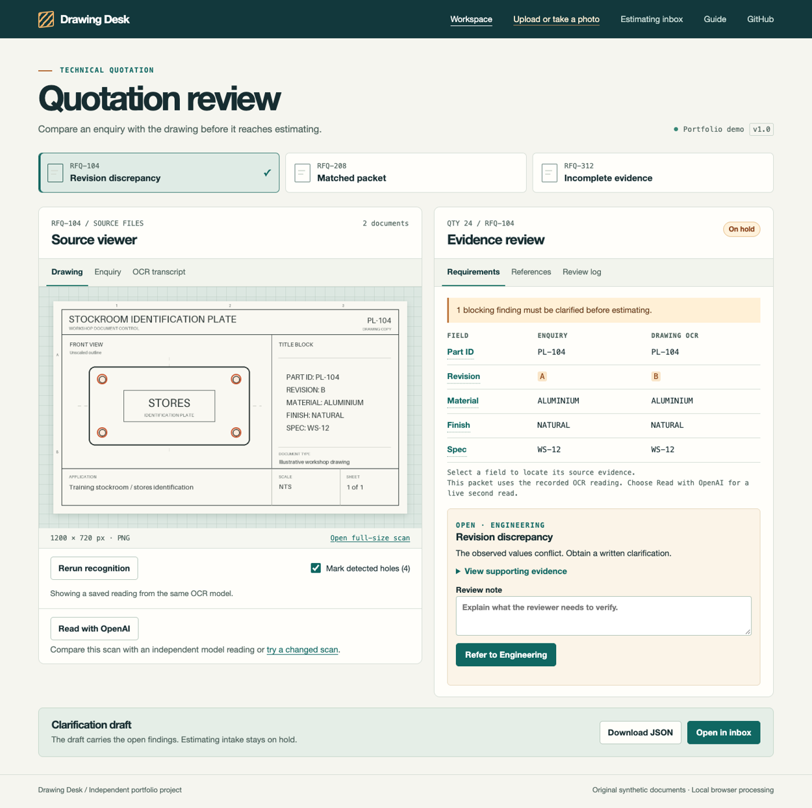

# Drawing Desk

A browser-based technical quotation review workspace. An estimator compares a customer enquiry with an engineering drawing, follows a discrepancy back to its source, records a clarification and transfers the checked packet to a separate estimating inbox.

**[Upload a drawing or use your camera](https://rongsenzhang.github.io/drawing-desk/upload.html) · [Open the quotation workspace](https://rongsenzhang.github.io/drawing-desk/) · [Read the operator guide](docs/operator-guide.md)**

| Try it | What to look for |
| --- | --- |
| [Read a sample image](https://rongsenzhang.github.io/drawing-desk/upload.html?sample=revision) | Inspect the prepared image. Run English OCR on your device, then select **Send to OpenAI** to compare an independent GPT-6.2 Astra reading. Check the part ID, revision, material, finish and specification against the image. |
| [Resolve an enquiry](https://rongsenzhang.github.io/drawing-desk/?case=revision) | Two source documents disagree. Follow the evidence, record the supplied customer clarification and transfer the checked packet to the [estimating inbox](https://rongsenzhang.github.io/drawing-desk/inbox.html). |
| [Change the scan](https://rongsenzhang.github.io/drawing-desk/scan-lab.html) | Remove a field from a copy of the matched drawing, rerun OCR on the changed pixels and watch how missing evidence affects the handoff. |

## A three-minute walkthrough

1. Open **Revision discrepancy**. The enquiry requests revision A. The drawing title block reads B. Select **Revision** to highlight the OCR line and inspect both sources.
2. Try **Rerun recognition** to run the bundled neural OCR model on the drawing pixels in your browser. Open **References** and look up the document-control clause.
3. Refer the discrepancy to Engineering with a reason. Read the supplied customer reply, record the supported revision, then select **Open in inbox**. The receiving page independently checks the handoff and records a local receipt.
4. Try **Incomplete evidence** to see why a referral without new evidence stays held. **Matched packet** supplies a clean control. A review can be restarted from its log.

The public samples use fictional workshop identification plates. Technical checks, literal source readings and effective values stay visible. The prototype prepares information for estimating. Pricing, commercial release and airworthiness decisions would require different authority and evidence.

## What runs

| Component | Behaviour |
| --- | --- |
| Drawing recognition | Tesseract LSTM reads a fixed title block on the three sample sheets. A separate connected-component detector locates isolated circular marks and overlays their positions. The initial display uses measurements previously produced by the same pipeline. |
| Photo and file comparison | The browser prepares a JPEG from a camera frame, JPEG, PNG or WebP. Local OCR reads the whole prepared image. Selecting **Send to OpenAI** transmits that JPEG through the hosted Worker to GPT-6.2 Astra. The server holds the credential. OCR text, filenames and sample answers stay out of the request. |
| Search and validation | BM25 ranks six sample clauses. Independent rules compare the two sources, verify quantity and reference currency, and create blocking findings. |
| Human review | A supported correction requires a referral, a reason and a matching written response. The original discrepancy stays in the record. |
| Integration | Both a JSON file and a same-tab transfer exercise a second estimating consumer. It replays the evidence and decisions, rejects changed or held documents and deduplicates received packets. |
| Delivery | GitHub Pages serves the browser application. A separate Worker provides optional hosted inference, with default limits of 100 attempts per UTC day and 5 per client per ten-minute window. Visitors use the site without a login or API key. |

Reviewer-uploaded images and readings last for the page visit. They remain provisional even where both readers agree. The inbox accepts replayable handoffs from the three controlled, fictional packets. Uploads have no associated controlled RFQ, clause set or customer clarification. The three original fixtures support testing and demonstration; no model was trained on them.

## Evidence and limits

The original three drawings yielded **15/15 expected field decisions** and **9/9 expected circular marks**. Across 18 originals and controlled variants, the recogniser returned **89/90 exact field decisions** and found **51/51 expected centres** with zero extras. On one downsampled image the OCR added a comma to the material. These are three designs from one template. Independent customer drawings and time savings have yet to be evaluated. [Vision method and results](docs/vision.md) · [Raw browser measurements](tests/vision-benchmark.json) · [WebKit measurements](tests/vision-webkit.json)

For eight hand-labelled relevant reference queries, six returned the intended clause first and seven returned it in the first three. Review the known wording miss and the negative controls in the [validation guide](docs/validation-engine.md).

The local recognition measurements above use the browser OCR and geometric detector. A separate cloud evaluation sends the image alone, captures returned observations and coordinates, then compares them with reference labels. The service tests use an HTTP test double and real SQLite transactions to exercise quotas and failure handling. Only a captured provider response counts as a live model observation. [OpenAI service method](docs/openai-service.md) · [Offline service tests](tests/service.test.mjs)

| Evidence | Question it answers |
| --- | --- |
| [Local OCR and geometry benchmark](tests/vision-benchmark.json) · [WebKit repeat](tests/vision-webkit.json) | Which expected fields and centres did the reproducible local pipeline find, and where did it fail? |
| Live provider benchmark, recorded separately in `tests/openai-benchmark.json` when calls complete | Which source fields did a paid model request actually return, what did it abstain on, and where did the two readers agree? Mock responses and quota tests do not contribute to this result. |
| [Reference search evaluation](docs/validation-engine.md) | Where does the intended clause rank, and what happens for queries without a relevant record? |

| Read more | Purpose |
| --- | --- |
| [Company and competitor research](docs/market-research.md) | The business setting, source inventory, overlapping manufacturers and comparable software. |
| [Seven-stage role map](docs/role-map.md) | Where each stage of the published NTU KTP project appears and what still needs an industrial partner. |
| [Technical design](docs/architecture.md) | System flow, implementation choices, acceptance checks and enterprise pilot path. |
| [Hosted reader](docs/openai-service.md) | Model request, image limits, evidence format, server credentials, usage limits and provider handling. |
| [Recognition measurements](docs/vision.md) | Reference labels, original and altered scans, positional errors and browser comparisons. |
| [Integration contract](docs/integration.md) | The receiver's schema, replay checks, limits and duplicate handling. |
| [Operator exercise](docs/operator-guide.md) | A walkthrough and a knowledge-transfer check for reviewers. |
| [Third-party notices](THIRD-PARTY-NOTICES.md) | Origins and licences of the vendored vision engine and model. |

## Run locally

Serve the repository over HTTP using `python3 -m http.server 8000`. Open [localhost on port 8000](http://localhost:8000/) for local OCR, image preparation, sample review and the inbox. The public hosted reader allows the published Pages origin. To run an end-to-end cloud path from a separate origin, configure a matching Worker origin and public service URL as described in the [service guide](docs/openai-service.md).

With Node 22 or newer, run `node --test tests/*.test.mjs` and `node scripts/evaluate-search.mjs` for the regression suite and retrieval benchmark. To repeat browser checks, run `npm ci`, `npx playwright install chromium`, then `npm run test:vision` and `npm run test:browser` with the server running. `BASE_URL` can target a deployed project. `BROWSER_ENGINE=webkit` selects an installed WebKit for workflow tests. GitHub Actions runs verification before publishing the browser assets. [Workflow](.github/workflows/pages.yml)

Independent portfolio project maintained by [Rongsen Zhang](https://github.com/rongsenzhang), developed with AI coding assistance. The public NTU / Midland Aerospace brief informed its scope. All bundled enquiries, drawings, customer responses and reference clauses were authored for this demonstration. The research links to the companies’ own material.
