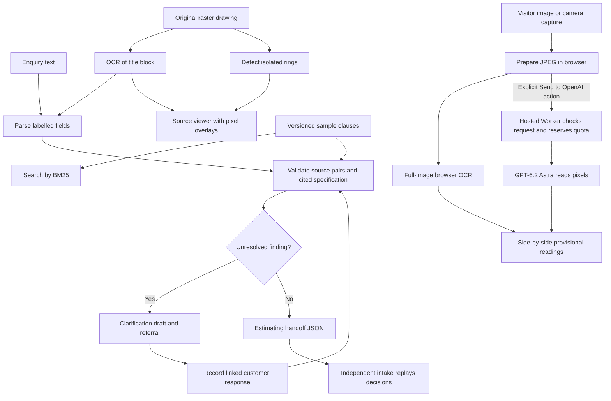

# Technical path to version 1.0

**Product decision.** Build a small pre-quotation workbench around a verifiable business decision. A reviewer compares an enquiry and a drawing, identifies an exception, records a response and hands the result to an estimating consumer. The original workshop label drawings allow public review of the entire processing chain. [Business evidence](market-research.md) · [Responsibilities and acceptance boundaries](role-map.md)

## Runtime and data flow

| Delivery step | Implementation | Acceptance check |
| --- | --- | --- |
| Discover | Inspect public services, approval documents, commercial terms, comparable manufacturers and quotation tools. Separate facts from assumptions. | Sources for business claims, documented access limits, list of questions for staff. |
| Model the workflow | Three cases with original enquiry text, labelled raster drawings, current and retired reference records, and one explicit customer response. | A matching packet, a conflicting revision and an absent specification produce different outcomes. |
| Build baseline | GitHub Pages serves responsive HTML, CSS and ES modules. The synthetic workspace and local OCR run in the browser. | First screen works from a project subpath. Published app loads the small stored fixture readings before fetching the OCR engine. |
| Recognise | Neural OCR reads the fixed title-block region. A separate pixel algorithm finds ring-shaped marks in a calibrated view. Both return source-pixel coordinates. | Run recogniser against original and altered input images and compare with explicit expected labels. [Vision evaluation](vision.md) |
| Test an altered input | The scan experiment transforms the matched fixture in the browser and feeds a new OCR result back into the same review logic. | Removing the visible specification makes the downstream review hold the case. |
| Compare independent readers | The image reader accepts a camera frame or file. One reader runs English OCR on the whole prepared image. On explicit submission, a Worker passes that image alone to GPT-6.2 Astra and validates the returned evidence. | For a readable model value, check its literal quote and source rectangle. Expose disagreement or uncertainty for a person to investigate. Invalid or unavailable results produce a visible status. [Service contract](openai-service.md) |
| Retrieve and validate | Label extraction, BM25 search and checks on source agreement, positive quantity and current specification. The search score ranks relevance; it never authorises a handoff. | Search benchmark and tests for missing, conflicting, duplicate, unknown and retired information. [Decision engine](validation-engine.md) |
| Handle exceptions | Keep original values, route findings, require a written reason plus a matching customer response to settle a conflict. Recheck earlier decisions against changed evidence. | A referral alone retains the hold. Only a supported resolution changes readiness. |
| Integrate | Versioned JSON can be downloaded or sent to a separate same-tab inbox consumer. It validates the submitted handoff and handles duplicate delivery. | Import a valid handoff, repeat it, alter a value, then try a held draft. [Integration contract](integration.md) |
| Release and transfer | Publish source, research, fixtures, model provenance, evaluation and staff exercise together on GitHub. GitHub Pages distributes only the browser assets. | Regression checks, browser walkthrough, deployment verification and a tagged release. [Operator guide](operator-guide.md) |

## System boundaries

The three inputs are intentionally small enough to inspect visually. Boundary and data ownership are explicit. Raw observations retain their provenance. The effective value sits alongside the original values after a supported decision. An unfilled specification or unsupported interpretation leaves the packet on hold. Ring counts are a visual observation and do not verify manufacturability. Tesseract supplies the pretrained model; no new OCR model was trained for this portfolio. The catalogue provides six independent sample references using fictional identifiers.

| Path | Data movement and ownership |
| --- | --- |
| Controlled sample review | Browser storage holds sample review history and receipts. A same-tab transfer uses session storage. The exported JSON is inspectable and the inbox replays it against the supplied sources. |
| Visitor file or camera | The browser draws the selected image or captured frame onto a fresh canvas and encodes a JPEG, up to 2,200 pixels on the longest side and 1 MiB. Preparation and full-image local OCR occur on the device. The visitor’s image and readings last for the page visit. |
| Explicit model request | **Send to OpenAI** sends the prepared JPEG through the hosted Worker. The Worker uses its own credential, high image detail and high reasoning effort with a fixed schema. It sends no external URLs, original filename, visitor-authored prompt, extracted text or reference answer. D1 reserves up to 100 attempts per UTC day and 5 per client per fixed ten-minute window by default. [Hosted reader](openai-service.md) |
| Estimating boundary | Both readings on a personal upload remain provisional. Intake accepts replayable sample handoffs. Organisational identity, access to authorised documents, tamper-evident records and a live ERP connector would be needed for an industrial handoff. |

## Moving from demonstration to industrial use

1. Interview estimating, engineering, quality and IT. Observe sample reviews and agree which omissions block a quote. Identify authoritative source systems and the owners of revisions, approvals and cost data. Establish a baseline for time and accuracy.
2. With permission, sample historic RFQs and split by customer and drawing family before training or tuning. Include multipage PDFs, scans, tables, tolerance notation, superseded specifications and edge cases. Keep an adjudicated holdout untouched. Compare the current OCR baseline with alternatives on extraction accuracy, critical misses, human correction time and cost.
3. In the company's Microsoft environment, evaluate controlled storage and retrieval for approved drawings and clauses, an authenticated approval workflow, and a read-only ERP adapter. Select cloud OCR or language models only if blind evaluation justifies their cost and data handling. Write-back needs a versioned contract, idempotency, role checks and audit events.
4. Start with a shadow pilot beside the existing process. Agree an escalation policy, sustainable false-hold rate and acceptable missed-requirement risk with the users. Introduce staff training, incident review, monitoring and operating ownership before controlled release.

These four steps are proposed enterprise milestones. The public release provides three controlled cases, an image-reading exercise for visitor files and camera frames, and separate evidence for each tested component.

## Inspecting a released model reading

The released sample packets include separate GPT-6.2 Astra readings captured from the deployed service. The workspace and receiving inbox replay them alongside the source-specific OCR pass. A disagreement, uncertain value, unsupported quote or model box that misses the corresponding OCR line centre produces an additional blocking finding. Both readers can share errors on unseen material. [Actual model outputs](../data/openai-readings.json) · [Exact-value and location measurements](../tests/openai-benchmark.json)
